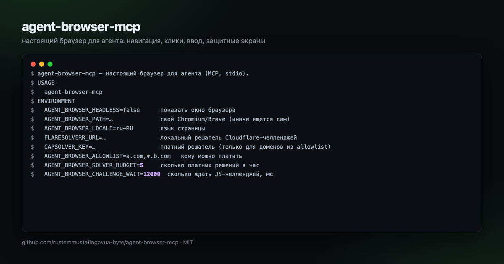

<div align="center">

# agent-browser-mcp

<p align="center">
  
</p>


**A real browser for your agent — navigation, reading, clicking, typing — with Cloudflare and captcha handling under a budget.**

[](https://github.com/rustemmustafingovua-byte/agent-browser-mcp/actions/workflows/ci.yml)
[](./LICENSE)
[](https://nodejs.org)

[Docs](https://github.com/rustemmustafingovua-byte/agent-browser-mcp#readme) · [Issues](https://github.com/rustemmustafingovua-byte/agent-browser-mcp/issues) · [Discussions](https://github.com/rustemmustafingovua-byte/agent-browser-mcp/discussions)

</div>

---

## Why

An agent that can only call APIs cannot read the pages that matter: the ones
behind a JavaScript wall, a cookie wall, or a bot check. This server gives it a
real browser — and handles the walls honestly, within a budget you set.

## What it does

| Tool | What it does |
|---|---|
| `browser_navigate` | opens a URL, detects a protection screen and works through it |
| `browser_read` | text of the page (or of one element) |
| `browser_links` | the page's links with anchor text |
| `browser_click` | click a CSS selector |
| `browser_type` | type into a field, optionally pressing Enter |
| `browser_wait_for` | wait for an element |
| `browser_screenshot` | PNG to a file or base64 |
| `browser_close` | release the browser |

## Install

```bash
npm i -g agent-browser-mcp
```

It uses the Chromium/Chrome/Brave already installed on the machine — nothing
extra to download. Point it at another binary with `AGENT_BROWSER_PATH`.

```jsonc
// ~/.config/opencode/opencode.jsonc
{
  "mcp": {
    "agent-browser": {
      "type": "local",
      "command": ["agent-browser-mcp"],
      "enabled": true
    }
  }
}
```

## How a protection screen is handled

```
1. direct load          the page opens normally
2. local FlareSolverr   your own solver, no keys, no third party
3. paid solver          only for domains on your allowlist, within the hourly budget
4. wait it out          a real browser solves most JS challenges on its own
```

The answer always says which path worked:

```json
{ "url": "…", "title": "…", "status": 200, "via": "direct", "challenged": false }
```

`via` is one of `direct`, `flaresolverr`, `capsolver`, `waited`, `blocked`.

## Policy (this part is deliberate)

- The paid solver is **never** called unless the domain is on the allowlist
  **and** the hourly budget is not exhausted. An empty allowlist means the paid
  path is off entirely.
- A local FlareSolverr is preferred over any paid service: your traffic, your
  machine, no data shared.
- No paywall or authorization bypass. The tool reads what the browser is
  allowed to see.
- Every solver call is counted, and the count resets hourly.

```bash
export AGENT_BROWSER_ALLOWLIST=example.com,*.example.org
export AGENT_BROWSER_SOLVER_BUDGET=5
export AGENT_BROWSER_CHALLENGE_WAIT=12000
export FLARESOLVERR_URL=http://127.0.0.1:8191   # optional, self-hosted
export CAPSOLVER_KEY=…                            # optional, paid
export AGENT_BROWSER_HEADLESS=false               # see the browser working
```

## Local FlareSolverr

```bash
docker run -d -p 8191:8191 --name flaresolverr ghcr.io/flaresolverr/flaresolverr:latest
```

## Stealth

The session hides the obvious automation markers: `navigator.webdriver` is
removed, the user agent, locale, timezone and viewport look like a normal
desktop. For deeper fingerprint work, point `AGENT_BROWSER_PATH` at a patched
browser build (rebrowser-playwright, patchright) and it will be used as is.

## Tests

```bash
npm test          # 7 unit tests: detection, allowlist, policy
LIVE=1 npm test   # + real browser against real pages
```

## Support

Every tool here is MIT and free. If it saved you time, you can support the work:

- **USDC (Base):** `0x8aC6a229f254980CCd3Dd35CF5E1B7c08880B40E`
- **GitHub Sponsors:** https://github.com/sponsors/rustemmustafingovua-byte

Paid tiers of the hosted services are billed per call in USDC (x402) — no accounts, no keys.

## License

MIT © rustemmustafingovua-byte
